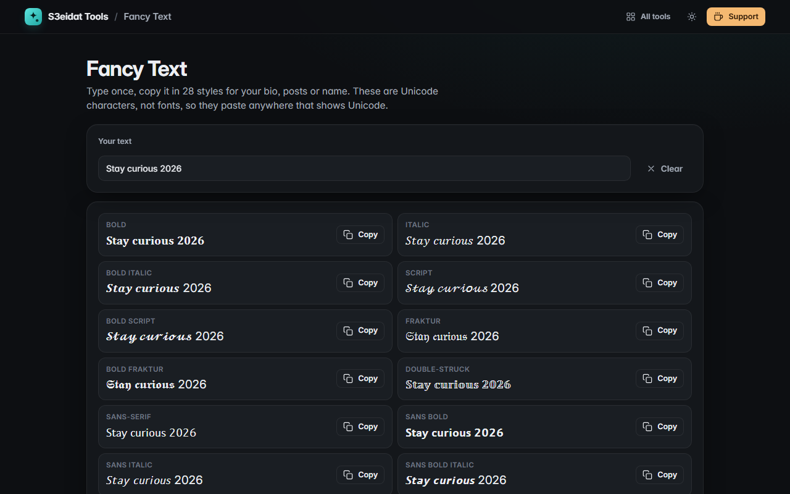

# Fancy Text

> 𝐁𝐨𝐥𝐝, 𝘪𝘵𝘢𝘭𝘪𝘤, 𝓈𝒸𝓇𝒾𝓅𝓉 and more for bios. Free, private, and it runs entirely in your browser.

### ▶ [Open Fancy Text](https://s3eidat.github.io/fancy-text/)



## Features

Type once and copy your text in **28 styles** with one click:

Bold · Italic · Bold italic · Script · Bold script · Fraktur · Bold fraktur · Double-struck · Sans-serif · Sans bold ·
Sans italic · Sans bold italic · Monospace · Circled · Circled dark · Squared · Squared dark · Parenthesized ·
Fullwidth · Small caps · Superscript · Upside down · Strikethrough · Underline · Double underline · Slashed ·
Overline · Wide spaced

- Uses the correct Unicode characters, including the letters Unicode keeps outside the main blocks (ℎ, ℬ, ℭ, ℝ…)
- Emoji, Arabic and other scripts pass through unchanged
- Remembers your last text on this device

## Accessibility note

These are Unicode symbols that look like letters, not a font. Screen readers may spell them out or skip them, and
search engines may not match them to normal words. Use them for decoration, not for important information.

## Privacy

Your text never leaves your device. There is no server, no account, no analytics.
The page ships with a strict Content-Security-Policy (`connect-src 'self'`), so the browser
itself blocks any attempt to send data anywhere.

## Run it yourself

It's plain HTML, CSS and JavaScript with no build step:

```bash
git clone https://github.com/s3eidat/fancy-text
cd fancy-text
python -m http.server 8000
```

Then open http://localhost:8000.

## Support

If this saved you time, **[buy me a coffee ☕](https://s3eidat.github.io/coffee/)**. It keeps every tool free.

---

Part of **[S3eidat Tools](https://s3eidat.github.io/)**: 100+ free, private tools that run in your browser. MIT licensed.
